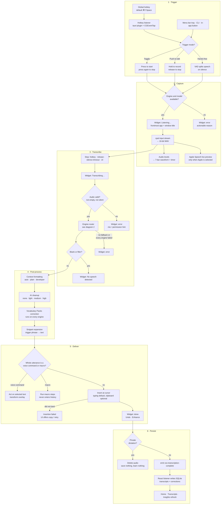
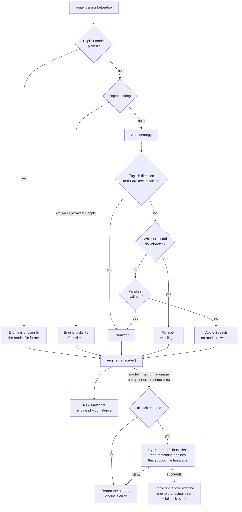
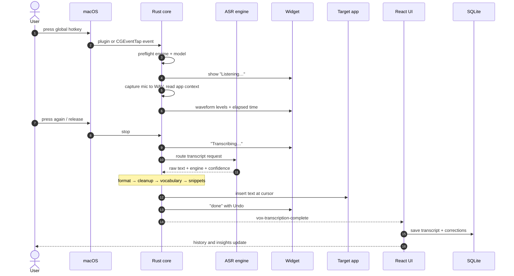
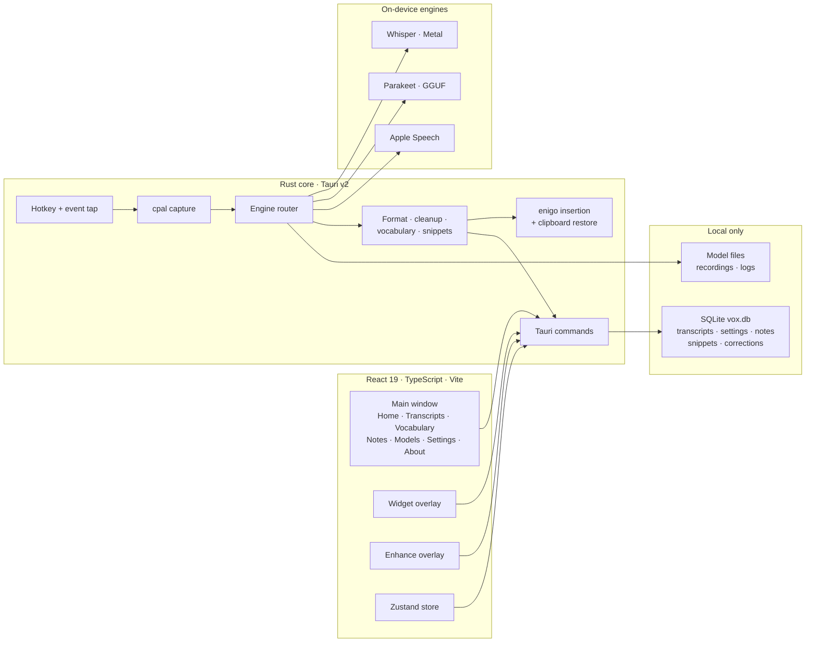

# Vox Workflow

How a dictation travels through the app, from the global hotkey to text at the
cursor and a row in SQLite.

## 1. End-to-end dictation loop

Notes:

- **Private dictation** (tray) skips history, vocabulary learning, and the
  completion event; the audio file is deleted after insertion.
- **Hands-free** keeps recording and emits a segment after each silence gap,
  so one session can insert and save several transcripts.
- **Developer formatting** short-circuits AI cleanup so dictated code, paths,
  flags, and symbols are never rephrased.
- A **pinned model** on the Models page wins over engine auto-selection.

## 2. Engine routing and fallback

Engine switches are never silent: they emit `transcription_engine_fallback`
and `transcription_engine_changed`, which the UI turns into warning/success
toasts.

## 3. Hotkey path, in sequence

## 4. Surfaces and storage

No cloud path exists by design: audio, transcripts, models, and history stay
on the machine.
